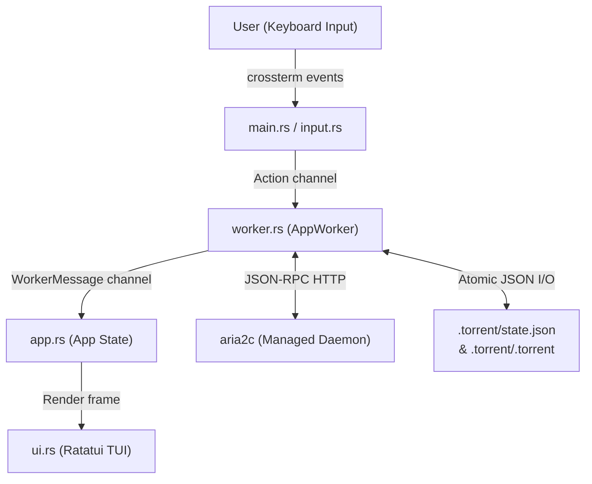

# grav-aria2-tui

A lightweight, high-performance BitTorrent Terminal User Interface (TUI) powered by `aria2c`. Built with Rust, Ratatui, Tokio, and Crossterm for Windows, Linux, and macOS.

```text
 ┌── GRAV-ARIA2 ─────────────────── [aria2c: active] ─── DL 0 B/s (∞)  ▲  UL 0 B/s ──┐
 │ dir: K:\Downloads                                                                   │
 │ Tags:  [All]   [distro]   [games]   [media]                                         │
 ├─────────────────────────────────────────────────────────────────────────────────────┤
 │ #  Name                       Size      Progress   Speed      ETA    Ratio  Status  │
 │ 1  archlinux-x86_64.iso       1.15 GB   100.0%     0 B/s      --     1.42   Seeding │
 │ 2  ubuntu-24.04-desktop.iso   5.80 GB    64.2%     12.4 MB/s  3m12s  0.15   Down... │
 │ 3  sample-dataset.tar.gz      820.0 MB    0.0%     0 B/s      --     0.00   Select..│
 └─────────────────────────────────────────────────────────────────────────────────────┘
```

---

## Overview

`grav-aria2-tui` provides a dedicated, keyboard-driven interface specifically for managing BitTorrent downloads and seeding without the overhead of heavy desktop clients or web UIs.

It orchestrates a local headless `aria2c` instance via JSON-RPC, running all network queries, state persistence, and subprocess operations in asynchronous background Tokio workers. The UI remains silky-smooth and responsive regardless of download speeds or torrent payload sizes.

---

## Architecture



- **Clean UI & Background Decoupling**: The UI never blocks on network or disk I/O. Actions are queued to `worker.rs`, and updates stream back through an asynchronous channel.
- **Embedded aria2c Process Supervision**: When started, `grav-aria2-tui` automatically boots a managed `aria2c` daemon configured for local RPC, sets safe defaults (`file-allocation=none`, `bt-save-metadata=true`), and performs a clean graceful shutdown on exit.
- **Portable, Self-Contained State**: Everything related to the download directory lives inside `<DIR>/.torrent/` — metadata, custom tags, file selection masks, and speed limits are saved in `state.json`.

---

## Key Features

### 🧲 Torrents & Magnet Links
- **Dual Ingestion**: Add downloads via `.torrent` file paths or `magnet:` URIs.
- **Automatic Magnet Metadata Archiving**: When a magnet link resolves its metadata from the swarm, `aria2c` saves `<info_hash>.torrent`, which `grav-aria2-tui` automatically moves and archives into `<DIR>/.torrent/`.
- **Fast Resume / Unverified Seeding**: Completed downloads resume seeding immediately without redundant hash-checking overhead via `bt-seed-unverified`.

### 📂 Interactive Pre-Download File Selection
- For multi-file torrents, open the file picker (`f`) to choose exactly which files to download before spending bandwidth.
- Supports individual toggling (`Space`), select all (`a`), deselect all (`n`), and batch start.

### 🏷️ Tagging & Batch Control
- Assign arbitrary tags (e.g. `distro`, `work`, `media`, `backups`) when adding torrents or on the fly (`t`).
- Cycle active tag views using `Tab` and `Shift+Tab`.
- Execute batch commands scoped to the currently filtered tag:
  - `S` (`Shift+s`): Batch start/resume all visible torrents.
  - `P` (`Shift+p`): Batch pause all visible torrents.

### ⚡ Bandwidth & Seeding Rules
- **Per-Torrent Limits** (`o`): Set custom download limits, upload limits, target seed ratio, and seed time.
- **Global Limits** (`g`): Configure global bandwidth caps and default seeding policies applied to all newly added torrents.

### 🔄 Startup Self-Healing & Auto-Import
- **Untracked File Discovery**: Drop any `.torrent` files directly into `<DIR>/.torrent/`, and `grav-aria2-tui` will prompt on startup to import and start them.
- **Dead Entry Pruning**: If payload files were moved or deleted outside the application, startup reconciliation cleans up orphan metadata entries.

---

## Installation & Requirements

### Prerequisites
1. **Rust**: Rust 1.75+ toolchain ([rustup.rs](https://rustup.rs/)).
2. **aria2c**: `aria2c` must be installed and available on your system `PATH` (or specified via `--aria2-bin`).
   - **Linux (Ubuntu/Debian)**: `sudo apt install aria2`
   - **macOS (Homebrew)**: `brew install aria2`
   - **Windows (Scoop)**: `scoop install aria2`
   - **Windows (Chocolatey)**: `choco install aria2`

### Building from Source

```bash
git clone https://github.com/your-username/grav-aria2-tui.git
cd grav-aria2-tui
cargo build --release
```

The compiled binary will be located at:
- `target/release/grav-aria2-tui` (Unix)
- `target/release/grav-aria2-tui.exe` (Windows)

---

## CLI Usage

```text
grav-aria2-tui [OPTIONS]
```

### Options

| Flag | Argument | Default | Description |
|---|---|---|---|
| `-d`, `--dir` | `<PATH>` | `.` | Root download directory and `.torrent/` metadata storage |
| `--rpc-url` | `<URL>` | `http://127.0.0.1:6800/jsonrpc` | aria2c JSON-RPC endpoint URL |
| `--rpc-secret` | `<TOKEN>` | *(none)* | Optional aria2c RPC authentication token |
| `--aria2-bin` | `<PATH>` | `aria2c` | Path or command name for the `aria2c` executable |
| `-h`, `--help` | | | Print help information |
| `-V`, `--version` | | | Print version |

### Examples

```bash
# Manage downloads in the current directory
grav-aria2-tui

# Specify an external downloads directory
grav-aria2-tui -d /mnt/storage/downloads

# Connect to an existing aria2c daemon with an RPC secret token
grav-aria2-tui -d "D:\Downloads" --rpc-url "http://127.0.0.1:6800/jsonrpc" --rpc-secret "my-secret-token"

# Specify a custom path to the aria2c binary
grav-aria2-tui --aria2-bin "C:\Tools\aria2\aria2c.exe"
```

---

## Keybindings Cheat Sheet

### Main View Navigation & Actions

| Key | Action |
|---|---|
| `j` / `Down` | Move selection down |
| `k` / `Up` | Move selection up |
| `Tab` / `]` | Next tag filter (`[All]`, `[tag1]`, `[tag2]`, ...) |
| `Shift+Tab` / `[` | Previous tag filter |
| `s` / `Space` | Toggle Start / Pause (loads archived `.torrent` if stopped) |
| `S` (`Shift+s`) | Batch Start all torrents in the active tag view |
| `P` (`Shift+p`) | Batch Pause all torrents in the active tag view |
| `a` | Add new torrent (path or `magnet:` URI + tags) |
| `f` | Open File Selection modal for the highlighted torrent |
| `t` | Edit tags for the highlighted torrent |
| `o` | Edit per-torrent limits (DL limit, UL limit, ratio, seed time) |
| `g` | Edit global options & limits |
| `v` | Force integrity re-check (`check-integrity=true`) and resume |
| `d` / `Delete` | Remove torrent (keep files or delete data from disk) |
| `q` | Save state and quit cleanly |

### Modals & Dialogs

- **Add Torrent Modal**:
  - `Tab` / `Down` / `Up`: Switch between Path/URI field and Tags field.
  - `Enter`: Add torrent.
  - `Esc`: Cancel.
- **File Selection Modal**:
  - `j` / `k` or `Up` / `Down`: Navigate file list.
  - `Space`: Toggle file inclusion.
  - `a`: Select all files.
  - `n`: Deselect all files.
  - `Enter`: Confirm selection and start download.
  - `Esc`: Close without changing selection.
- **New Torrents Detected Modal**:
  - `Space`: Toggle individual candidate torrents.
  - `a` / `n`: Select all / None.
  - `Enter` / `y`: Import and immediately start downloading.
  - `s`: Import in stopped state.
  - `Esc`: Ignore.
- **Remove Torrent Confirmation**:
  - `1` / `2` or `Up` / `Down`: Switch between *Remove from list (keep files)* and *CONFIRM DELETE DATA*.
  - `Enter`: Confirm action.
  - `Esc` / `n`: Cancel.

---

## Directory Structure & State Management

All state is persisted in a hidden `.torrent/` subfolder inside the target download directory:

```text
<DOWNLOAD_DIR>/
├── .torrent/
│   ├── state.json                 <-- State database (metadata, limits, tags)
│   ├── state.json.tmp             <-- Atomic write staging
│   ├── <info_hash_1>.torrent      <-- Archived bencoded metadata
│   └── <info_hash_2>.torrent
├── payload_folder_1/
│   ├── video.mp4
│   └── subs.srt
└── linux-distro.iso
```

### Atomic State Persistence
State updates are written to `state.json.tmp` and atomically renamed over `state.json` (with Windows-compatible file replacement fallbacks). If power is cut mid-write, your state file remains uncorrupted.

---

## Project Structure

```text
src/
├── main.rs      # CLI parsing, process setup, terminal raw mode, main loop
├── app.rs       # Application state (App), modals, torrent models, tag caching
├── worker.rs    # Tokio background actor: RPC calls, file operations, startup scan
├── input.rs     # Keyboard event dispatch for main view and all modal dialogs
├── ui.rs        # Ratatui rendering (header, table, status bar, modals)
├── rpc.rs       # Type-safe aria2 JSON-RPC client
├── process.rs   # aria2c subprocess lifecycle management and graceful shutdown
├── state.rs     # State persistence, bencode parser (BEP-52 compliant), startup sync
├── utils.rs     # Format utilities (bytes, speeds, ETA) and path sanitization
└── cli.rs       # Command-line interface definition (clap derive)
```

---

## Diagnostics & Logging

`grav-aria2-tui` uses `env_logger`. By default, diagnostic logging is suppressed so it doesn't interfere with the TUI screen. To enable logging to a file or terminal during development:

```bash
# Log to a file while running the TUI
RUST_LOG=info grav-aria2-tui 2> debug.log
```

---

## License

MIT or Apache 2.0. See LICENSE for details.
